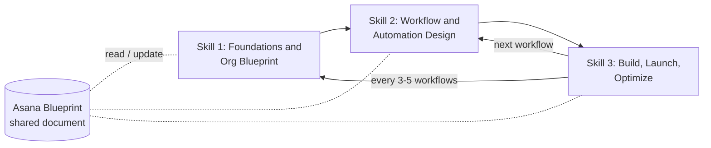

# Asana Coach Skills

Three connected skills for Claude that coach someone with **zero Asana experience** all the way to an organized, automated workspace for any business: org structure, workflows, automations, launch and continuous improvement.

The skills teach as they go. Every new idea is explained in plain language with an example from the user's own business, decisions are made through short multiple-choice question rounds with a recommended answer, and each stage produces a concrete document the next stage builds on.

## The skills

| # | Skill | What it does | Produces |
|---|---|---|---|
| 1 | [`asana-foundations-and-org-design`](skills/asana-foundations-and-org-design/SKILL.md) | Teaches the Asana mental model, interviews the user about their business, designs teams, portfolios and projects, ranks the processes to automate | Blueprint §1-3: org profile, structure map, workflow backlog |
| 2 | [`asana-workflow-automation-design`](skills/asana-workflow-automation-design/SKILL.md) | Maps one process as it is today, simplifies it, then translates it into sections, fields, a form, rules and a dashboard | Blueprint §4: Workflow Spec |
| 3 | [`asana-build-launch-optimize`](skills/asana-build-launch-optimize/SKILL.md) | Builds the spec in a safe order, tests every branch, launches with role guides, reviews at 2/30/60/90 days | Blueprint §5-6: build log, launch and review log |

After skill 3, the loop returns to skill 2 for the next workflow. Every 3 to 5 workflows, skill 1's structure step is revisited for organization-level optimization.



Full description: [docs/workflow-overview.md](docs/workflow-overview.md).

## The shared document: the Asana Blueprint
All three skills read and update one document, so work can stretch across many sessions without starting over. Template: [templates/asana-blueprint-template.md](templates/asana-blueprint-template.md).

1. Org profile
2. Structure map
3. Workflow backlog (ranked)
4. Workflow specs
5. Build log
6. Launch and review log
7. Decisions and open questions

## Installing

**Claude apps (claude.ai / desktop):** zip each folder inside `skills/` (the zip must contain the folder with its `SKILL.md`) and upload it in the Skills section of Claude's settings. Install all three; they hand off to each other by name.

**Claude Code:** copy the folders into `~/.claude/skills/` (personal) or `.claude/skills/` in a project:

```bash
git clone https://github.com/Theonewhomutsreaminunknown/asana-coach-skills.git
cp -r asana-coach-skills/skills/* ~/.claude/skills/
```

**Optional but helpful:** an Asana connector (lets Claude read the workspace and create projects and tasks) and browser tools (lets Claude build rules, forms and dashboards in the Asana web app). Without them the skills switch to coach mode and give click-by-click instructions.

## How to start
Say something like:

> "I've never used Asana. Help me organize my business in it."

Skill 1 starts, asks where you are, and leads you through the rest. To jump straight to one process: "Help me design an Asana workflow for our purchase approvals" (skill 2). To build an existing spec: "Build this workflow spec in Asana" (skill 3).

## Repository layout

```
skills/                       the three skills (one folder each, SKILL.md inside)
docs/workflow-overview.md     how the series works, stage by stage
docs/best-practices.md        Asana design, automation, testing and rollout best practices
templates/                    Blueprint and Workflow Spec templates
examples/                     a worked example (purchase approval workflow)
```

## Where this came from
The lessons inside these skills come from designing and deploying real Asana workflows for a public-sector organization: event intake with marketing fan-out, tiered expenditure approvals, recurring events, dashboards and org-wide rollout. Organization-specific details were removed; the patterns, limits and safety practices were kept.

## Notes
- Asana features and limits change and depend on the plan. The skills tell Claude to verify before promising; please open an issue if something here is out of date.
- See [CONTRIBUTING.md](CONTRIBUTING.md) to propose improvements.
- Released under the [MIT License](LICENSE): free to use, copy, modify and share.
