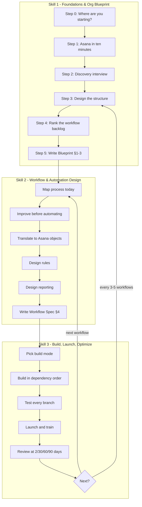

# How the Asana Coach series works

The series turns "I've never used Asana" into a running, automated organization in repeatable stages. Each skill has a clear entry condition, a fixed set of steps, and an output written to the shared **Asana Blueprint**.

## Coaching method (all three skills)
- **Explain once, in context.** Each Asana concept is explained the first time it appears, with an example from the user's own business.
- **Designed question rounds.** 1 to 4 multiple-choice questions per round, always with a recommended option and an "I'm not sure" option, and one line on why it's being asked.
- **Play back.** After each round Claude summarizes what it heard and gets confirmation.
- **Show, don't just tell.** A table or diagram at least every second round.
- **Recommend.** Beginners get a default and the reason for it.
- **Verify before promising.** Plan features and rule limits are checked, and uncertain capabilities are tested in a scratch project.

## Skill 1: Foundations and Org Blueprint
**Starts when:** someone is new to Asana, or wants to organize a whole team or organization.

| Step | Purpose | Key questions / content |
|---|---|---|
| 0 Where are you starting | Fit the coaching to the person | Experience level, Asana plan, org size, goal |
| 1 Asana in ten minutes | Build the mental model | Hierarchy (workspace → team → portfolio → project → section → task → subtask), fields, views, forms, rules; five principles; sandbox exercise |
| 2 Discovery interview | Understand the business | The business, how work arrives and is tracked, pain points, goals/KPIs; "walk me through the last time…" |
| 3 Structure | Decide teams, portfolios, goals, projects | Naming and access conventions; anti-patterns |
| 4 Backlog | Choose what to automate first | Score frequency, pain, reach, ease; pick a quick win with a willing owner |
| 5 Blueprint | Record and hand off | Blueprint §1-3 plus decisions |

## Skill 2: Workflow and Automation Design
**Starts when:** there is one process to put into Asana (ideally picked from the backlog).

| Step | Purpose | Key questions / content |
|---|---|---|
| 1 Map today | See the real process | Trigger, intake, stages, decisions, handoffs, done, exceptions, volume; swimlane diagram |
| 2 Improve | Don't automate waste | Steps with no value, waiting, habit vs policy approvals, parallel work |
| 3 Translate | Map to Asana objects | Form, task, sections, custom fields, subtasks/templates, approvals, cross-team tasks |
| 4 Automations | Design rules | Trigger → check if → actions; pattern library; known limits; edge cases |
| 5 Reporting | Answer leadership's questions | One chart per question |
| 6 Spec | Write it down and get sign-off | 11-part Workflow Spec |

## Skill 3: Build, Launch, Optimize
**Starts when:** a Workflow Spec has been approved.

| Step | Purpose | Key content |
|---|---|---|
| 1 Build mode | Choose how hands-on | Coach, assisted, or mixed |
| 2 Build | Avoid rework and surprise notifications | Fixed order: project → fields → form → templates → rules → dashboard → people |
| 3 Test | Prove every path | Test table; branches, edge cases, non-admin submitter |
| 4 Launch | Get adoption | Go-live checklist; role quick guides; retire the old process |
| 5 Optimize | Improve with evidence | Usage, bottlenecks, cycle time, overdue, workarounds; one change at a time |
| 6 Loop | Keep going | Next workflow; periodic structure review; maturity ladder |

## Maturity ladder
1. Tasks with owners and dates
2. Process projects with forms
3. Automated routing and approvals
4. Portfolios and dashboards leaders actually read
5. Goals linked to work, reviewed on a regular rhythm
